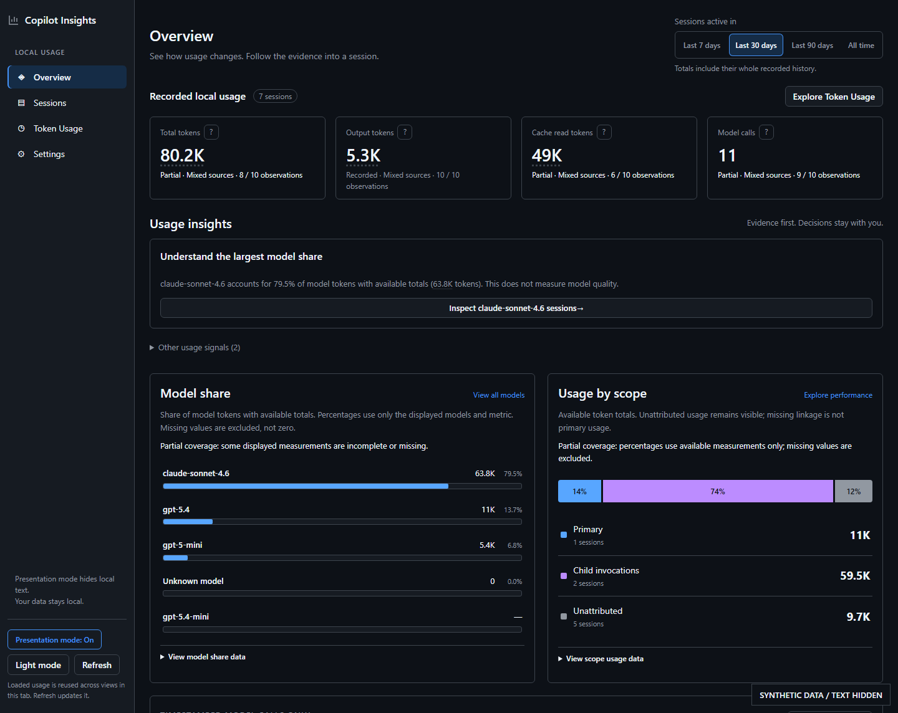
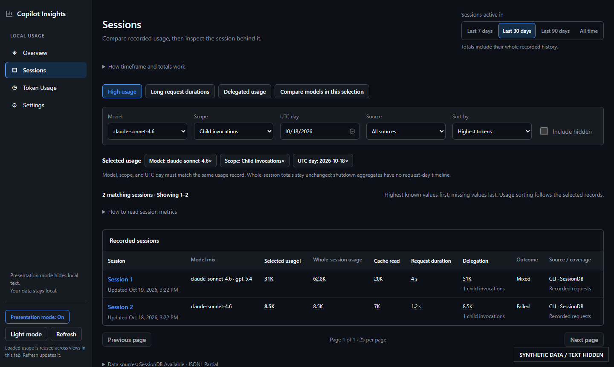
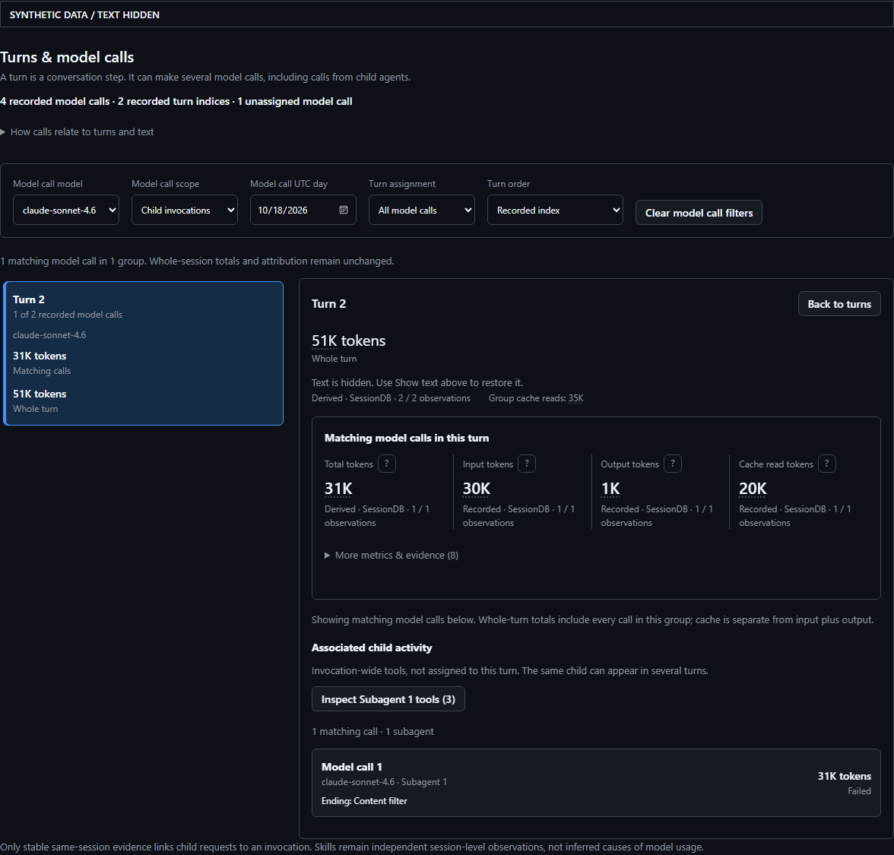
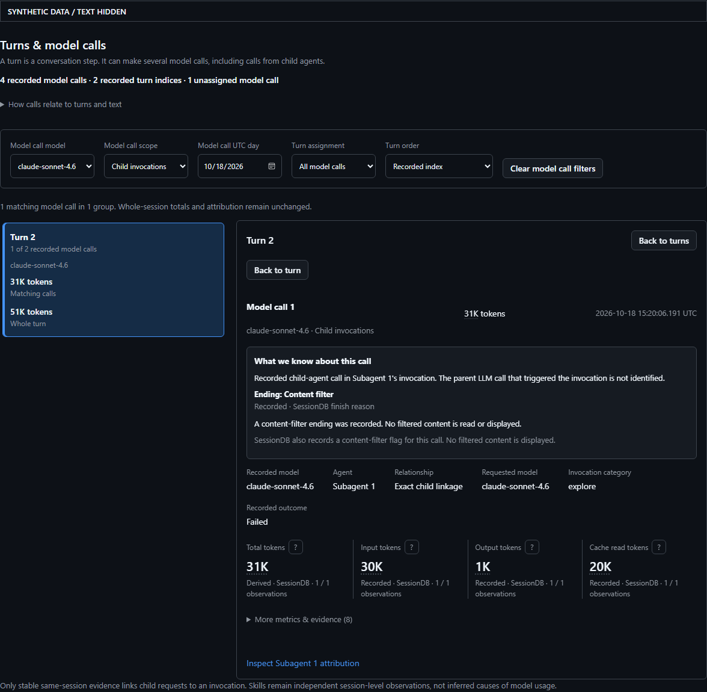
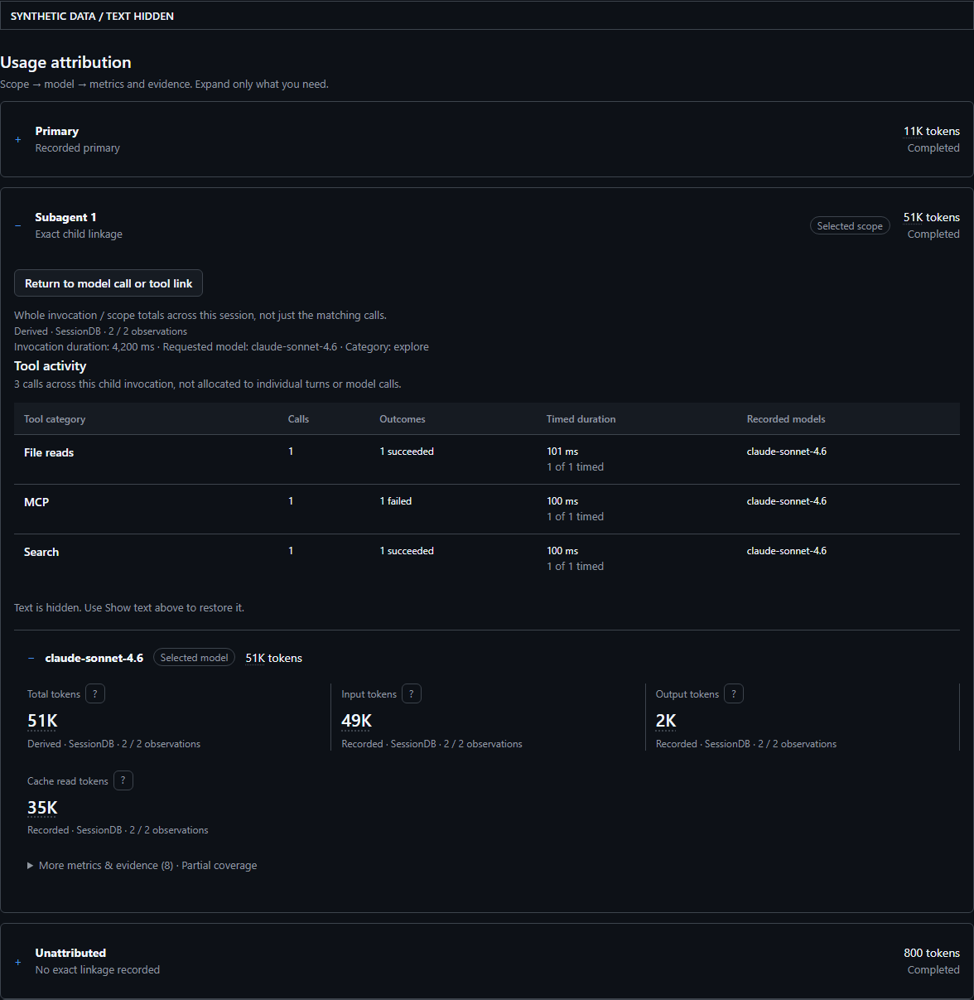
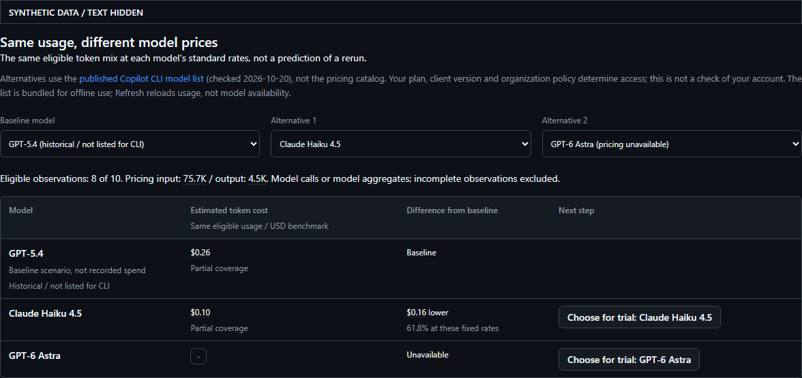
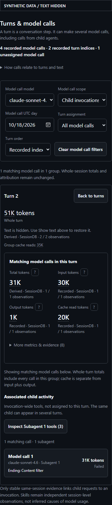

<p align="center">
  
</p>

# Copilot Insights

**Understand your Copilot usage. Find an optimization worth trying.**

A local-first dashboard and optional CLI extension for investigating models,
tokens, cache, turns, and primary/subagent usage. Find an expensive session,
inspect the recorded evidence, then try one manual change.

> Independent community project. Not affiliated with, endorsed by, or sponsored
> by GitHub or Microsoft.
>
> **Session Detail shows original local conversation text by default.** Enable
> **Presentation mode** before screen sharing. Usage analytics exclude text;
> the separate local viewer does not guarantee redaction.

## Quick start

Requires **Node.js 20+** and existing local **Copilot CLI** sessions.
Windows, macOS, and Linux are supported.

### Install or upgrade

Windows:

```powershell
irm https://raw.githubusercontent.com/jackbatzner/copilot-insights/main/scripts/install.ps1 | iex
copilot-insights
```

macOS / Linux:

```bash
curl -fsSL https://raw.githubusercontent.com/jackbatzner/copilot-insights/main/scripts/install.sh | bash
copilot-insights
```

The installers verify the latest release's SHA-256 checksum and install with
npm. Rerun to upgrade. Open **http://localhost:3002**, or choose another port
with `copilot-insights --port 3003`.

### From source

```bash
git clone https://github.com/jackbatzner/copilot-insights.git
cd copilot-insights
npm install
npm start
```

Installation builds the UI. `npm run setup` is the explicit bootstrap alternative.

### Optional CLI extension

Run `copilot-insights link`, then `/extensions reload` in Copilot CLI.
Use `copilot-insights unlink` to remove the link.

The extension provides safe usage summaries, model comparisons, session
drill-downs, and dashboard launch/stop. `insights_sessions` returns 25 sessions
per page; retain filters and pass `page: 2` to continue. Use a returned opaque
handle with `insights_session` for details. It does not expose conversation text.

## A focused workflow

| Destination | Use it to |
| --- | --- |
| **Overview** | Find usage patterns and open an investigation from a graph. |
| **Sessions** | Filter by model, scope, or UTC request day and compare matching usage with whole-session totals. |
| **Token Usage** | Explore models, observed Agent & Skill Performance, and model comparisons. |
| **Settings** | Check Data Sources, optional-source preferences, and Presentation mode. |

Start with a high-usage model in **Token Usage**, follow it to **Sessions**, and
inspect a costly turn. Check child attribution, choose one manual change, and
save a metric-only baseline to compare with a later session. The app never
changes your Copilot configuration automatically.

### Inspect turns and model calls

Session Detail has **Turns**, **Agents & models**, and **Tool activity** views.
Select a turn, then a call to inspect its model, tokens/cache, latency, outcome,
and source evidence. Desktop uses a list beside an inspector; mobile uses
**Back to turns**. Source and lifecycle diagnostics sit below the explorer.

Call ending labels describe how calls stopped, **not why the next call began**.
Retries, tool continuations, and causal ordering are not inferred. Child
ownership requires exact same-session linkage; missing ownership stays
unattributed. Tool categories cover recorded executions, not tool-level token
costs. Skills remain session-level counts, not proven causes of model usage.

### Compare models

**Observed usage** shows recorded metrics. **What-if cost** applies dated
standard token rates to a fixed workload: **benchmarks, not your Copilot bill**.
Incomplete observations are excluded with coverage shown; cache accounting
remains an explicit assumption. Unknown prices and unverified monetary
conversions stay unavailable.

Trial choices use the public CLI support catalog checked **October 20, 2026**,
not an account-entitlement check. Retired models remain in history and saved
baselines, but not new trial choices. Refresh reloads usage, not the catalog.
See the [compatibility review](docs/copilot-compatibility-2026-10-15.md) for
sources, retirements, identifier limits, and deferrals.

Save one local metric-only baseline, make a manual change, then **Check for newer
sessions**. Comparisons use whole-session history, not incremental billed usage
or a controlled experiment. Fewer tokens do not prove equal quality or savings.
The baseline persists until replaced, cleared, or removed with browser site data.

### Loading and navigation

Cold history and new filters can require a scan. Loading placeholders show
pending sections; a longer-wait message appears after ten seconds, and failures
offer Retry. Revisiting a view can reuse a bounded in-tab usage cache. Private
text never enters that cache.

**Refresh** reloads usage. **Reload app** on an error screen reloads updated
application files while retaining URL filters.

## Data and attribution

The baseline is read-only local **SessionDB + session-state JSONL**. Optional
sources live under **Settings -> Data Sources**; there is no OTel requirement
or importer.

- Recorded SessionDB usage takes precedence over JSONL fallback, without
  double-counting. Aggregate-only history cannot reconstruct turns or calls.
- Missing metrics are not zero. Cache is separate from input/output, and summed
  request durations are not elapsed session time.
- Timeframes select sessions by activity; totals cover their whole history.
  Daily graphs use verified request timestamps instead.
- Raw nano-AIU and request-cost fields have no verified currency or local-credit
  conversion. Unsupported conversions display **Not recorded**.
- There is no verified person/owner dimension, team ranking, or task-quality score.

## Privacy

Usage API/CLI output excludes prompts, replies, commands, arguments/results,
paths, arbitrary source names/errors, and raw identifiers. Anonymous labels
and opaque handles support navigation. No session data is uploaded to an
external analytics service.

**The local text viewer is a separate exception.** Session Detail displays
bounded original turn text and exactly linked child prompts, which may contain
sensitive information. Text stays out of usage responses, logs, shared caches,
exports, and persistent app storage. **Hide all text** clears previews/panels,
cancels reads, and saves Presentation mode across navigation and reload.
Only the visibility preference is saved.

The server is loopback-only, not a public or multi-user service. Presentation
mode does not make real usage suitable for a public screenshot. See
[Security and privacy](SECURITY.md) for the full boundary and reporting guidance.

## Screenshot gallery

All 17 gallery images use isolated **synthetic data with text hidden**,
refreshed October 20, 2026. They are examples, not real usage or savings.
Older local videos are historical and do not show the current UI.



<details>
<summary>Sessions, turns, and attribution</summary>









</details>

<details>
<summary>Model comparisons and mobile</summary>





</details>

Browse [all gallery images](docs/screenshots).

## Upgrading from the earlier dashboard

Analytics is now part of **Overview** and **Sessions**; Skill Building's observed
performance is under **Token Usage**. Live diagnostics are contextual in Session
Detail, and VS Code setup is under **Settings -> Data Sources**.

Global Instructions/snippets, Practice Lab, Dev Plan/Journal, and Chronicle were
removed, not hidden. Existing hidden-session and source preferences migrate from
bounded app metadata. Removed features' files are neither read nor automatically
deleted.

## Development

See [Contributing](CONTRIBUTING.md) for architecture, validation, synthetic
browser checks, and [gallery capture](CONTRIBUTING.md#screenshot-gallery).
Keep real session stores, logs, transcripts, and machine-local artifacts out of
contributions.

## Releasing

Use the **Manual release** GitHub Actions workflow from `main`, or
`npm run release patch`. Both commit and publish; neither is a validation
command. `npm run release patch --dry-run` previews the local release.

## Troubleshooting

Check **Settings -> Data Sources** for missing history and capability limits.
See [Support](SUPPORT.md) for loading, model, dependency, and port issues.
Share only sanitized diagnostics or synthetic reproductions, never your source
database or transcripts.

## License

[MIT](LICENSE)
